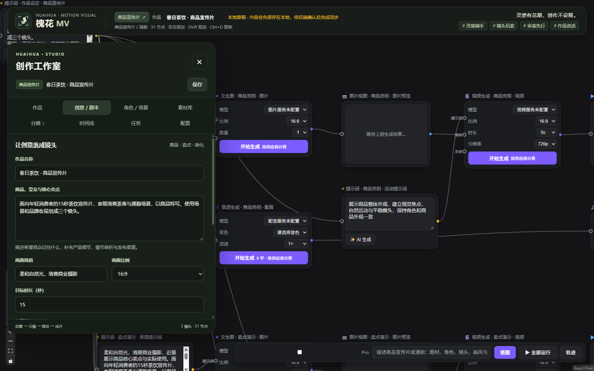

<p align="center">
  
</p>

# 槐花MV · Huaihua MV

**灵感有花期，创作不设限。**

面向商品宣传片与分集漫剧的节点式 AI 创作工作台。把商品素材、角色设定、剧本、分镜、视频和配音留在同一张画布里，沿着节点连接推进制作，最后输出带音轨与字幕的成片。

*A local-first, node-based creative workspace for product commercials and animated drama, from scripts and storyboards to video, voice and final export.*

**灵感捕手 · 镜头玩家 · 审美先行 · 作品说话**

[快速启动](#快速启动) · [使用手册](docs/GUIDE.md) · [参与贡献](CONTRIBUTING.md) · [更新记录](CHANGELOG.md)



*界面预览：商品宣传片的本地模板与制作工作室。模板可直接编辑，AI 媒体生成需要另行配置供应商。*

## 为两种创作场景准备

| | 商品宣传片 | 漫剧 / 分集故事 |
| --- | --- | --- |
| 从哪里开始 | 商品、受众、卖点、使用场景 | 世界观、角色关系、冲突、分集剧本 |
| 复用什么 | 商品参考图、品牌要求、场景素材 | 角色参考图、场景、角色声音 ID |
| 怎样推进 | 商品亮相 → 卖点演示 → 品牌收尾 | 开场建立 → 冲突发展 → 结尾悬念 |
| 怎样交付 | 按镜头顺序导出一支宣传片 | 导出指定一集或完整作品 |

漫剧默认画风为 **电影感国漫**，可按作品修改。参考图会实际连接到镜头的图片生成输入；最终商品细节与角色一致性仍需人工检查。

## 把想法做到成片

- **可编辑的节点画布**：拖动、连线、缩放、框选、复制与分组，保留创作过程和素材引用。
- **完整的作品资料**：管理剧本、角色、场景、分集、镜头时长和台词。
- **本地素材库**：上传、搜索和复用图片、视频、音频，把现有素材应用到镜头。
- **模板与 AI 规划**：先用模板搭建可编辑分镜；配置文字服务后，可请求 AI 规划和提示词辅助。
- **制作任务管理**：按依赖运行图片、视频、配音和音画合成，查看结果、取消或手动重试。
- **成片导出**：镜头裁切、顺序拼接、混音、烧录字幕，以及 MP4 字幕轨道。
- **本地保存与恢复**：浏览器草稿、SQLite 自动保存、项目切换前同步，以及任务回执恢复。

制作顺序：**创意 / 剧本 → 角色与素材 → 分镜 → 镜头媒体 → 时间线 → 成片**。

## 快速启动

准备 **Python 3.10+、FFmpeg 和 FFprobe**。在下载后的项目根目录执行以下 Windows 命令：

```powershell
python -m venv .venv
.\.venv\Scripts\python.exe -m pip install -r backend/requirements.txt
.\.venv\Scripts\python.exe -X utf8 backend/app.py --open
```

浏览器打开 <http://127.0.0.1:5088/>。之后也可双击 **启动槐花MV.bat**。用户运行预构建前端即可，无需安装 Node.js；详细安装与其他启动方式见 [使用手册](docs/GUIDE.md#安装与启动)。

**先不用 API Key 也能体验**：创建作品 → 使用本地模板 → 上传自己的视频与音频 → 应用到镜头 → 裁切并导出。按 [第一个成片教程](docs/GUIDE.md#无需-api-key-完成第一个成片) 完成一次制作。

## 按需接入 AI

复制 [配置示例](.env.example) 为 `.env`，配置需要的文字、图片、视频或配音服务后重启。支持 OpenAI 格式的文字、图片、语音接口，以及 Seedance 和 `/videos` 兼容协议适配。

模型菜单来自本地配置，生成费用由供应商收取。**接口适配已实现，真实供应商兼容性和生成质量需要配置后验证**；“已配置”表示配置项齐全，不代表已发起真实验证。详见 [模型服务配置](docs/GUIDE.md#模型服务配置)。

## 当前状态

| 范围 | 状态 |
| --- | --- |
| 作品、素材、角色、分集、分镜编辑 | 本地可用 |
| 现有视频 / 音频的镜头合成与导出 | 已通过真实本地媒体测试 |
| AI 分镜、图片、视频与配音适配 | 已实现，需要用户配置服务；未完成真实供应商验证 |
| 运行环境 | 已在 Windows 验证；其他系统的完整兼容性尚未验证 |
| 使用方式 | 本地单用户；没有团队账户、协作权限或公网部署方案 |
| 发布与许可 | 源码已公开；许可证待确认 |

当前版本不包含完整修图工具、视频延展、团队协作或应用市场，也不承诺一次生成就能得到可直接发布的长篇漫剧。

## 数据放在哪里

作品和任务存入 `data/canvas.db`，素材与成片存入 `data/studio-media/`；浏览器同时保留本地草稿。调用 AI 时，相关提示词与参考素材会发送给你配置的供应商。密钥保存在本机环境或 `.env`，界面不返回密钥。

备份前停止应用，再复制完整 `data/` 目录。具体操作见 [保存与备份](docs/GUIDE.md#保存与备份)。

## 技术栈

React 19 · TypeScript · React Flow · Zustand · Vite · Flask · SQLite · FFmpeg

前端源码位于 `frontend/src/`，后端分为作品与素材、供应商任务、媒体处理三个模块。开发环境与测试命令见 [贡献指南](CONTRIBUTING.md#本地开发)。

## 项目结构

```text
槐花MV/
├── backend/                 # Python 应用、接口、服务与后端测试
│   ├── app.py               # 实际应用入口
│   ├── config.py            # 读取根目录 .env，数据保持在根目录 data/
│   ├── modules/             # 作品、素材、生成任务与 FFmpeg 服务
│   ├── static/              # 前端构建产物与品牌资源
│   ├── templates/           # Flask 页面模板
│   ├── tests/               # 后端回归与媒体集成测试
│   └── requirements.txt
├── frontend/                # React + TypeScript + Vite
│   ├── src/                 # 节点、工作室、状态与执行器
│   ├── tests/               # 执行器测试
│   ├── package.json
│   └── vite.config.ts
├── docs/
│   ├── assets/              # 可公开的文档截图
│   └── GUIDE.md             # 使用手册
├── scripts/
│   └── start.ps1            # Windows 启动逻辑
├── .env.example
├── .gitignore
├── app.py                   # 兼容原 python app.py 命令
├── requirements.txt         # 兼容原安装命令，引用后端依赖
├── start.ps1                # 兼容原 PowerShell 启动入口
├── 启动槐花MV.bat
├── 启动画布.bat
├── README.md
├── CONTRIBUTING.md
└── CHANGELOG.md
```

`data/` 和 `output/` 是本地运行目录，`.local/` 保存旧版本、提取来源和迁移备份；这些目录均排除在 Git 提交之外。根目录只保留公开说明、配置示例和启动入口。

## 反馈与参与

欢迎在本仓库 Issues 中反馈问题、提出创作需求，或贡献可复用模板、模型适配与文档改进。提供复现步骤和脱敏日志，会让问题更容易定位。

阅读 [贡献指南](CONTRIBUTING.md) 了解参与方式；阅读 [更新记录](CHANGELOG.md) 了解当前改动。

## 后续方向

- 更多商品行业模板和电影感国漫分镜模板。
- 补充经过真实验证的供应商配置与兼容性说明。
- 改进素材复用、镜头预览和时间线编辑体验。

这些是迭代方向，没有承诺完成时间，具体进展以更新记录为准。

## 许可证

项目许可证尚未确认，后续核对原始代码与依赖的许可后补充 `LICENSE`；当前未声明 MIT、Apache 或其他开源许可。
